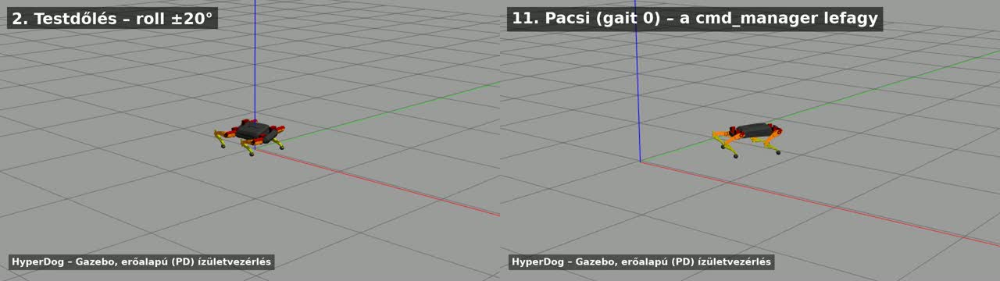

# Hiperkutya (HyperDog) – működő Gazebo-szimuláció és a javításai

A [HyperDog](https://github.com/NDHANA94/hyperdog_ros2) egy nyílt forrású, 12 szabadságfokú, négylábú robot. ROS2-n fut (Foxy), a lábakat egy STM32 hajtja micro-ROS-on át. Az eredeti repóban van Gazebo-szimuláció (`hyperdog_gazebo_sim`), de **változtatás nélkül nem működik**. A modell betöltődik, a robot viszont nem mozdul, vagy feláll, de nem halad, csak csúszik.

Ez a repó leírja, mi a baj, és tartalmazza a javításokat. Egy paranccsal indítható Docker-környezet is van benne, amelyben a robot jár, oldalaz és fordul, és böngészőből vezérelhető.



Videó az összes mozgásmódról: [media/hyperdog_demo.mp4](media/hyperdog_demo.mp4) (74 s).

**Tesztkörnyezet:** ROS2 Foxy, Gazebo 11, Ubuntu 20.04 (Docker), az eredeti repó [`604f836`](https://github.com/NDHANA94/hyperdog_ros2/tree/604f8362f3e09d3b3246abac832ae82323ffa97d) commitja (2024-09-08).

---

## Tartalom

- [Gyors indítás Dockerrel](#gyors-indítás-dockerrel)
- [Az eredeti problémák](#az-eredeti-problémák)
- [Javítás saját ROS2-telepítésen](#javítás-saját-ros2-telepítésen)
- [Hibakeresés: hol akad el a parancs?](#hibakeresés-hol-akad-el-a-parancs)
- [Mérések](#mérések)
- [Ismert korlátok](#ismert-korlátok)
- [Fájlok](#fájlok)

---

## Gyors indítás Dockerrel

Csak Docker kell hozzá, ROS-t nem kell telepíteni. A build kb. 10 perc.

```bash
git clone https://github.com/sribence/hiperkutya-gazebo.git
cd hiperkutya-gazebo
docker build -t hiperkutya-gazebo .
docker run -d --name hiperkutya -p 6080:6080 -p 6081:6081 hiperkutya-gazebo
```

Kb. 30 másodperc múlva:

- **Gazebo képe a böngészőben:** http://localhost:6080/vnc.html?autoconnect=1&resize=scale
- **Vezérlőpult:** http://localhost:6081

A vezérlőpult billentyűi nyomva tartva működnek, és ehhez a pult fülének kell aktívnak lennie:

| Billentyű | Mozgás |
|---|---|
| **F** | felállás |
| **W / S** | előre / hátra |
| **A / D** | oldalazás balra / jobbra |
| **Q / E** | fordulás balra / jobbra |
| **szóköz** | megállás |
| **R** | reset: a robot állva visszakerül az origóba |

A pulton vannak csúszkák a testmagassághoz (80–240 mm) és a testdőléshez (roll, pitch, yaw), valamint egy járásmód-választó. A pult ugyanazt a `/hyperdog_joy_ctrl_cmd` üzenetet küldi 10 Hz-en, amit a gamepad-teleop küldene. A ROS-oldalon tehát minden úgy fut, mint a valódi robotnál.

Hasznos parancsok:

```bash
docker exec -it hiperkutya bash      # belépés; benne: source /ws/install/setup.bash
docker exec hiperkutya tail -f /tmp/cmd.log   # naplók: sim, cmd, pd, ik, web .log
docker restart hiperkutya
docker rm -f hiperkutya
```

A konténer `ROS_DOMAIN_ID=77`-tel fut, így nem keveredik a hálózaton lévő más ROS2-forgalommal.

---

## Az eredeti problémák

A hibák egymásra rakódnak. Ha egyet megjavítasz, a következő még megállíthatja a robotot, és a legtöbb hiba **hibaüzenet nélkül** jelentkezik: a robot egyszerűen nem mozdul.

A sorszámok az eredeti repó `604f836` commitjára vonatkoznak. Mind a 7 kódhibát a [`fixes/apply_fixes.sh`](fixes/apply_fixes.sh) javítja.

### 1. A launch fájl hibával leáll

- **Tünet:** `ModuleNotFoundError: No module named 'black'`
- **Hely:** `hyperdog_gazebo_sim/launch/hyperdog_gazebo_sim.launch.py`, 27. sor: `from black import out`
- **Ok:** egy szerkesztő automatikusan beszúrt egy fölösleges importot. A `black` kódformázó, a launch nem használja.
- **Javítás:** a sor törlése.

### 2. A cmd_manager azonnal összeomlik, ha van grafikus felület

- **Tünet:** `ModuleNotFoundError: No module named 'tkinter'` a `cmd_manager_node` indításakor. A `/hyperdog_geometry` topic néma.
- **Hely:** `hyperdog_ctrl/gait_generator/gait_planner.py`, 26. sor: `import matplotlib.pyplot as plt`. A fájl csak egy hibakereső rajzhoz használja.
- **Ok:** ha van `DISPLAY`, a matplotlib a Tk-backendet keresi, ami nincs telepítve. Fej nélküli gépen (például a robot Jetsonján SSH-ról) a hiba nem jön elő, ezért a fejlesztőnél nem látszott.
- **Javítás:** `matplotlib.use("Agg")` az import előtt. Kódmódosítás nélküli alternatíva: `MPLBACKEND=Agg ros2 run hyperdog_ctrl cmd_manager_node`, vagy `sudo apt install python3-tk`.

### 3. Járásparancsra a robot lefagy egy felemelt lábbal („pacsi”-hiba)

- **Tünet:** a robot feláll, de a járás bekapcsolásakor felemel egy lábat, és úgy marad. A `/hyperdog_geometry` elhallgat, és a cmd_manager semmire nem reagál többé.
- **Hely:** `hyperdog_ctrl/gait_generator/gait_planner.py`, `give_hand()`, 529–531. sor:
  ```python
  while self.cmd.mode.gait_type == 0:
      self.FR_traj[0] = self.cmd.gait.step_len[0]
      self.FR_traj[2] = self.cmd.gait.step_len[1]
  ```
- **Ok:** a `gait_type` alapértéke **0**, ez a „pacsi” mód (`give_hand`). Az alapérték a `hyperdog_ctrl/cmd_manager/hyperdog_variables.py` 32. sorában van, és a teleop is 0-val indul. A ciklus alvás nélkül pörög, ezért lefoglalja a Python közös zárját (GIL), és a ROS-szál nem tud se fogadni, se küldeni. Ha a járásmódot senki nem választja ki, a robot az első járásparancsra lefagy.
- **Javítás:** `time.sleep(0.01)` a ciklusba. Ezzel a pacsi módból újraindítás nélkül vissza lehet váltani trotra, és a robot tovább jár (mérve). Javítás nélkül a gamepaden járás előtt a **B** gombbal kell trotot választani (A = 0 pacsi, B = 1 trot, X = 2 wave gait, Y = 3 gyors trot).
- **Megjegyzés:** ez a **valódi robotot is érinti**, nemcsak a szimulációt.

### 4. A robot feláll, de nem halad, és a talpai csúsznak

- **Tünet:** minden topic él, a lábak mozognak, mégis 10 s alatt kb. 3 mm-t halad előre. Állva is lassan elfordul (kb. 0,4°/s). A repó saját README-je is említi a csúszást.
- **Ok:** két hiba együtt.
  1. A `hyperdog_gazebo_sim/description/consts.xacro` 18., 21. és 24. sorában a csuklósúrlódás `friction="10000"`, ami gyakorlatilag befagyasztja a csuklókat. A sebességkorlát (12. sor) 1 rad/s, ami járáshoz kevés.
  2. A Foxy-s `gazebo_ros2_control` (0.1.x) pozíciós parancs-interfész esetén nem erővel mozgatja a csuklót, hanem a szögét közvetlenül átírja (`SetPosition`). A csukló „teleportál”, a talp nem tud a talajhoz képest erőt kifejteni, és elcsúszik.
- **Javítás: erőalapú (nyomatékos) vezérlés.**
  - `gazebo_ros2_control_plugin.xacro`: mind a 12 ízület parancs-interfésze `position` helyett `effort`, ±10 Nm korláttal.
  - `consts.xacro`: súrlódás 0, sebességkorlát 20 rad/s.
  - `config/hyperdog_joint_controller.yaml`: `ForwardCommandController` helyett `effort_controllers/JointGroupEffortController`, frissítés 100 Hz helyett 500 Hz.
  - `launch/hyperdog_gazebo_sim.launch.py`: a gyári fok→radián híd (`hyperdog_gz_joint_ctrl_node`) kikapcsolva.
  - Új node: [`tools/pd_bridge.py`](tools/pd_bridge.py). Szervóként működik: a célszögből (IK, fok) és a mért szögből és szögsebességből (`/joint_states`) nyomatékot számol, `tau = kp·(cél − szög) − kd·szögsebesség`, korlátozva. Alapértékek: kp = 30 Nm/rad, kd = 0,6 Nm·s/rad.

  Az eredmény: kb. 4,5 cm/s trot, oldalazás és fordulás.

### 5. Hibás „mindent indító” launch fájl

- **Tünet:** a `hyperdog_gazebo_sim_allPkgs.launch.py` hibával leáll.
- **Ok:** egy nem létező `hyperdog_control` csomagra hivatkozik (95. és 100. sor).
- **Javítás:** ne ezt használd. A `hyperdog_gazebo_sim.launch.py` működik, a vezérlő node-okat pedig külön kell indítani (lásd lent).

### 6. Nincs, ami parancsot küldjön

- **Tünet:** minden node fut, de a robot fekve marad.
- **Ok:** ez nem hiba, csak könnyű elfelejteni. A Gazebo magától nem mozgatja a robotot. Parancs csak gamepadről (`joy_node` + `hyperdog_teleop_joy_node`) vagy saját publisherből jön a `/hyperdog_joy_ctrl_cmd` topicra. Először a start kell (`states[0]`, gamepaden Start gomb): erre feláll. Utána a walk (`states[1]`, Back gomb): erre lép.
- **Javítás:** a Docker-környezetben ezt a [`tools/hd_web.py`](tools/hd_web.py) webes pult végzi.

### 7. Ártalmatlan, de félrevezető üzenet

- **Üzenet:** induláskor a Gazebo másodpercenként ezt írja: `command size (0) does not match number of interfaces (12)`
- **Ok:** az IK, amíg nem kap parancsot, üres tömböt küld. Nem okoz hibát. A `pd_bridge.py` kiszűri.

### A környezet buktatói (nem a robotkód hibái)

- **Lejárt ROS apt-kulcs:** a régi `osrf/ros:foxy-desktop` image-ben a csomagforrás kulcsa lejárt, ezért az `apt-get update` hibát dob. Javítás: a friss `ros.key` letöltése, lásd a [`Dockerfile`](Dockerfile)-t.
- **Beragadt FastDDS:** ha sokszor indítasz és lősz ki (`pkill`, Ctrl+C) `ros2 topic pub` vagy más node-folyamatokat, a FastDDS egy idő után beragadhat a `/dev/shm`-ben. Az új publisher üzenetei ilyenkor nem érnek célba, hibaüzenet nincs. Javítás: mindent újraindítani. Ezért vezérel egyetlen, tartósan futó node (`hd_web.py`) a sok egyszeri `ros2 topic pub` helyett.
- **Szünetel a szimuláció:** ha a Gazebo alsó sávjában a Sim Time nem nő, a pause be van nyomva. Feloldás: `gz world -p 0`. A webes pult minden gombnyomáskor feloldja.
- **A `gz world -r` nem teszi vissza a robotot:** a ros2_control mellett a világ resetje nem helyezi vissza a modellt. Ehelyett: `gz model -m HyperDog -x 0 -y 0 -z 0.18 -R 0 -P 0 -Y 0`. Magasabbról ne ejtsd le, mert felborulhat.
- **Fekete noVNC-kép `docker restart` után:** az Xvfb régi lockfájlja (`/tmp/.X1-lock`) megakasztja az indulást. A [`docker/run.sh`](docker/run.sh) indításkor törli.
- **Eltűnő robot:** ha a robot kimegy a képből, a kamerát rá lehet állítani: `gz camera -c gzclient_camera -f HyperDog`. A pult ezt induláskor és resetkor megteszi.

---

## Javítás saját ROS2-telepítésen

Ha nem Dockert használsz, hanem a saját ROS2 Foxy workspace-edet (Ubuntu 20.04):

```bash
sudo apt install ros-foxy-gazebo-ros-pkgs ros-foxy-gazebo-ros2-control ros-foxy-ros2-control \
                 ros-foxy-ros2-controllers ros-foxy-xacro ros-foxy-joy

cd ~/hyperdog_ws/src/hyperdog_ros2              # az eredeti repó gyökere
bash /útvonal/hiperkutya-gazebo/fixes/apply_fixes.sh .
cd ~/hyperdog_ws
colcon build --packages-select hyperdog_msgs hyperdog_gazebo_sim hyperdog_ctrl hyperdog_teleop
source install/setup.bash
```

A szkript a végén ellenőrzi magát. Ha mind a 7 javítás illeszkedett, ezt írja ki: `Mind a 7 javítás rendben.` Ha az eredeti repó azóta megváltozott, név szerint jelzi, melyik javítás nem talált. A szkript többször is lefuttatható.

Indítás. Mindegyik sor külön terminálban fusson, és mindegyikben legyen `source install/setup.bash`:

```bash
ros2 launch hyperdog_gazebo_sim hyperdog_gazebo_sim.launch.py   # várd meg, amíg a robot megjelenik
python3 /útvonal/hiperkutya-gazebo/tools/pd_bridge.py           # a nyomatékos szervó-szabályzó
ros2 run hyperdog_ctrl cmd_manager_node
ros2 run hyperdog_ctrl IK_node
ros2 run joy joy_node                                           # gamepaddel
ros2 run hyperdog_teleop hyperdog_teleop_joy_node
```

Gamepaden: **Start** (feláll), **B** (trot), **Back** (járás be/ki), a botokkal pedig irányítod. Gamepad helyett a webes pult is működik:

```bash
python3 /útvonal/hiperkutya-gazebo/tools/hd_web.py   # majd: http://localhost:6081
```

A PD-erősítések futás közben is állíthatók:

```bash
ros2 param set /pd_bridge kp 40.0
ros2 param set /pd_bridge kd 0.8
ros2 param set /pd_bridge effort_limit 5.0
```

A `pd_bridge.py` szabályzó-függvénye ROS nélkül is ellenőrizhető: `python3 tools/pd_bridge.py --test`.

Más ROS2-verzió (Humble, Iron) esetén a `gazebo_ros2_control` viselkedése eltérhet: újabb verziókban a pozíciós mód már nem feltétlenül teleportál. Az 1–3. és az 5. hiba ott is fennáll, mert ezek a robot saját kódjában vannak.

---

## Hibakeresés: hol akad el a parancs?

A parancs ezen a láncon halad végig:

```
gamepad → joy_node → hyperdog_teleop ─┐
          (vagy tools/hd_web.py) ─────┴→ /hyperdog_joy_ctrl_cmd   (hyperdog_msgs/JoyCtrlCmds)
  → cmd_manager_node → /hyperdog_geometry
  → IK_node → /hyperdog_jointController/commands   (12 szög, fokban)
  → tools/pd_bridge.py  (+ /joint_states) → /gazebo_joint_controller/commands   (12 nyomaték, Nm)
  → Gazebo (ros2_control)
```

A gyári, pozíciós változatban a `pd_bridge.py` helyén a `hyperdog_gazebo_joint_ctrl_node` áll, és szögeket küld radiánban.

Ha bármelyik szem hiányzik vagy lefagy, a robot áll. Nézd meg sorban, melyik topic az első néma:

```bash
ros2 node list
ros2 control list_controllers                     # joint_state_broadcaster és gazebo_joint_controller: active
ros2 topic hz /hyperdog_joy_ctrl_cmd              # jön parancs?
ros2 topic hz /hyperdog_geometry                  # él a cmd_manager? (néma: 2., 3. vagy 6. hiba)
ros2 topic hz /hyperdog_jointController/commands  # él az IK?
ros2 topic hz /gazebo_joint_controller/commands   # eljut a Gazebóig?
gz model -m HyperDog -p                           # a test helyzete: x y z (m), roll pitch yaw (rad)
```

**A `JoyCtrlCmds` üzenet mezői** (ha saját publishert írsz):

| Mező | Jelentés |
|---|---|
| `states[0]` | start: a robot feláll |
| `states[1]` | walk: járás |
| `states[2]` | side_walk_mode: hamis = oldalazás, igaz = fordulás a `gait_step.y` szerint |
| `gait_type` | 0 = pacsi (lefagyasztja a javítatlan kódot!), 1 = trot, 2 = wave gait, 3 = gyors trot |
| `pose.position.z` | testmagasság, mm (80–240) |
| `pose.orientation.x/y/z` | roll / pitch / yaw, fok |
| `gait_step.x` | lépéshossz előre (+) / hátra (−), mm |
| `gait_step.y` | oldalirány: negatív = balra |
| `gait_step.z` | lábemelés magassága, mm |

---

## Mérések

Mérés a Docker-környezetben, sík talajon. Valós időhöz viszonyított sebesség (RTF) kb. 0,97.

| Teszt | Gyári (pozíciós) mód | Javított (erőalapú) mód |
|---|---|---|
| Felállás 150 mm-re | 16,3 cm testmagasság | 15,7 cm (kicsit enged, mint egy terhelt szervó) |
| Állás | lassan elfordul, kb. 0,4°/s | nem fordul el |
| Roll 20° / pitch 15° parancs | 21,9° / −13,4° | 22,6° / −13,2° |
| Trot előre | 3 mm / 10 s | 67 cm / 15 s (kb. 4,5 cm/s) |
| Hátra | – | 36 cm / 10 s |
| Oldalazás | – | 41 cm / 10 s |
| Fordulás | – | kb. 70–90° / 10 s |

---

## Ismert korlátok

- **A pitch előjele fordított** a parancs és a Gazebo-tengely között: +15° parancsra −13° lesz. IMU-alapú önszintezésnél ezt figyelembe kell venni.
- **Oldalra húz.** Egyenes járásnál is elfordul kb. 10°-ot 15 s alatt. Jó mérési feladat: lépéshossz, lábemelés, PD-erősítés hatása.
- **A szimulált szervó (PD, ±10 Nm) valószínűleg erősebb és gyorsabb a valódinál.** A valódi szervó adatlapjából pontosítható (`effort_limit`, sebességkorlát a `consts.xacro`-ban).
- **A modellben nincs IMU-szenzor.** Önszintezés teszteléséhez fel kell venni egy `<gazebo reference="base_link"><sensor type="imu">` blokkot a `libgazebo_ros_imu_sensor.so` pluginnal. Ferde talaj a world fájlba tehető.
- **A javítás a pacsi módot nem javítja meg, csak a lefagyást szünteti meg.** A `give_hand()` mozgása a gyári kódban sem teljes.

---

## Fájlok

| Fájl | Mi ez |
|---|---|
| [`fixes/apply_fixes.sh`](fixes/apply_fixes.sh) | az összes kódjavítás az eredeti forrásra, kommentekkel és önellenőrzéssel |
| [`tools/pd_bridge.py`](tools/pd_bridge.py) | PD-szabályzó node: szögparancsból nyomaték (erőalapú mód) |
| [`tools/hd_web.py`](tools/hd_web.py) | böngészős vezérlőpult (gamepad helyett), billentyűzettel |
| [`Dockerfile`](Dockerfile) | Foxy + Gazebo + az eredeti repó rögzített commitja + javítások + noVNC |
| [`docker/run.sh`](docker/run.sh) | a konténer indítószkriptje (kijelző, Gazebo, node-ok, pult) |
| [`media/`](media/) | demóvideó és kép |

## Licenc és forrás

Az eredeti HyperDog szoftver: [NDHANA94/hyperdog_ros2](https://github.com/NDHANA94/hyperdog_ros2), © 2024 W.M. Nipun Dhananjaya Weerakkodi, MIT-licenc. Ez a repó az eredeti fájlokat nem tartalmazza: a build során letölti őket, és a javításokat szkripttel alkalmazza. A repó saját tartalma szintén MIT-licencű, lásd a [LICENSE](LICENSE) fájlt.
