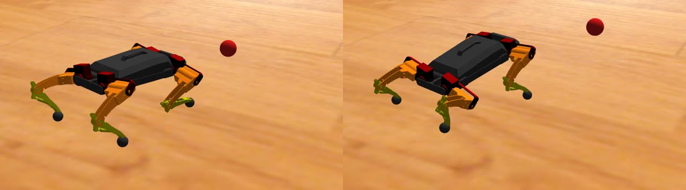

# Célkövetés: a robot a célpont felé fordul és fel/le néz

A robot álló helyzetben a teste elfordításával (yaw) és megdöntésével (pitch) a célpont felé néz.
A célpontot egy külön program adja meg **térbeli pontként, méterben**. A követő nem kap
kameraképet és bounding boxot. Ami a kameraképből a pontot előállítja, az külön program, és nem része ennek a repónak.

```
kamera ─▶ felismerő ─▶ [ hallgatói program ] ──/target_point──▶ target_follower ──▶ cmd_manager ─▶ IK ─▶ …
           (bounding box)  bbox → 3D pont, szűrés,                     ▲
                           biztonság, formázás     gamepad / pult ──/teleop_cmd
```

A Gazebóban a hallgatói program helyén a `tools/sim_target.py` áll: egy mozgó piros labda
helyzetét küldi ugyanebben a formátumban.



## Az üzenet, amit a követő vár

| | |
|---|---|
| Topic | `/target_point` |
| Típus | `geometry_msgs/msg/PointStamped` |
| `header.frame_id` | `base_link` |
| `header.stamp` | annak a kameraképnek az ideje, amelyből a pont készült |
| `point.x` | előre, méterben (a test közepétől) |
| `point.y` | balra, méterben |
| `point.z` | felfelé, méterben |
| Gyakoriság | 10–30 Hz (amilyen gyakran a felismerő eredményt ad) |
| Ha nincs cél | **ne küldj semmit**. A követő 1 s-ig tartja az irányt, utána lassan visszaáll egyenesbe |

A koordináta-rendszer a robot testéhez rögzített, nem a kamerához. A kamera optikai
koordinátáit (RealSense: x jobbra, y lefelé, z előre) a küldőnek kell átszámolnia: ehhez
kell a kamera helye és dőlése a test közepéhez képest. Ha a test elfordul, a kamera vele
fordul, és a pont is a test új helyzetéhez képest értendő. Ez így helyes, a követő erre számít.

Minimális küldő, csak a formátum kedvéért:

```python
from geometry_msgs.msg import PointStamped
pub = node.create_publisher(PointStamped, "target_point", 10)

msg = PointStamped()
msg.header.stamp = kep_ideje              # a kamerakép időbélyege, nem a küldés ideje
msg.header.frame_id = "base_link"
msg.point.x, msg.point.y, msg.point.z = x, y, z   # méter, x előre, y balra, z fel
pub.publish(msg)
```

Kézi próba egyetlen ponttal (0,8 m előre, 0,3 m balra, 0,1 m fel):

```bash
ros2 topic pub -r 10 /target_point geometry_msgs/msg/PointStamped \
  "{header: {frame_id: base_link}, point: {x: 0.8, y: 0.3, z: 0.1}}"
```

Üres (nulla) időbélyegnél a követő nem nézi a pont korát. Kézi próbánál ez kényelmes, éles
használatban viszont mindig töltsd ki.

## Mit fogad el a követő

A követő a bemenetet nem hiszi el vakon. Eldobja a pontot, ha

- valamelyik koordináta nem véges szám (`nan`, `inf`),
- a pont a robot mögött van (`x <= 0`),
- 0,3 m-nél közelebb vagy 5 m-nél távolabb van (`min_dist`, `max_dist`),
- az időbélyege 0,5 s-nál régebbi (`max_age`).

Az eldobott pontokat 5 másodpercenként egy figyelmeztetés jelzi a naplóban (`/tmp/follower.log`).

A parancsot is korlátozza:

- **Szöghatár:** yaw ±30°, pitch ±10° (`max_yaw`, `max_pitch`).
- **Sebességhatár:** legfeljebb 60°/s (`max_rate`).
- **Csak álló, felállt robotnál fordít.** Felállás után 3 s-ig vár (`settle`).
- **Járás és ülés:** közben a pult/gamepad szögeit engedi át, és nem gyűjti a hibát.

## A hallgatói program feladata

Ezeket a lépéseket kell megoldani, mielőtt a pont a `/target_point`-ra kerül:

1. **Bounding boxból 3D pont.**
   - A doboz egy pontjához tartozó mélység a RealSense mélységképéből.
   - Ebből a kamera belső paramétereivel (intrinsics) a kamera koordinátái.
   - Gondold végig, melyik pixelt vagy pixeleket érdemes használni: a doboz közepe lehet háttér is.
2. **Kamera → `base_link` átszámítás.** A kamera rögzítési helyét és dőlését meg kell mérni a roboton.
3. **Szűrés.**
   - Zaj és ugrások ellen: egy-egy hibás mélységérték ne rántsa el a robotot.
   - Rövid kiesésnél (egy-két kép) mi történjen.
   - Több jelölt esetén melyik a cél.
4. **Biztonság.**
   - Mikor ne küldjön pontot: bizonytalan felismerés, túl közeli ember, régi adat.
   - A követő is szűr, de a jó döntést a küldő tudja meghozni, mert ő látja a képet.
5. **Formázás:** a fenti üzenet, helyes időbélyeggel és `frame_id`-val.

Ellenőrzésnek elég a Gazebo: `TARGET=on` módban a követő a te `/target_point`-odat követi.

## Kipróbálás a Docker-környezetben

Szimulált labdával:

```bash
docker run -d --name hiperkutya -e TARGET=sim -p 6080:6080 -p 6081:6081 hiperkutya-gazebo
```

Utána a pulton „Felállás” (F). 3 s múlva a robot a labda felé kezd fordulni.

Saját célpont-forrással (a `/target_point`-ot te küldöd):

```bash
docker run -d --name hiperkutya -e TARGET=on -p 6080:6080 -p 6081:6081 hiperkutya-gazebo
```

A konténer `ROS_DOMAIN_ID`-ja 77. Ha a küldő programod a konténeren kívül fut, ezt kell beállítanod neki is.
Ugyanazon a gépen a `--network host` kapcsoló kell a `docker run`-hoz.

A `sim_target.py` paraméterei (`--ros-args -p nev:=ertek`):

| Paraméter | Jelentés |
|---|---|
| `sweep`, `period` | oldalirányú mozgás (fok) és periódusidő (s) |
| `pitch_sweep`, `pitch_period` | fel-le mozgás |
| `distance` | távolság (m) |
| `delay`, `noise` | késleltetés (s) és zaj (m) |

Ha más paraméterekkel akarod futtatni, állítsd le a konténerben futót, és indítsd újra:

```bash
pkill -f sim_target.py
python3 /opt/hiperkutya/sim_target.py --ros-args -p use_sim_time:=true -p sweep:=10.0
```

## Fizikai roboton

Ugyanez a `target_follower.py` fut, a következő eltérésekkel:

- **Időforrás:** `use_sim_time` nélkül.
- **Átirányítás:** a teleopot át kell irányítani, hogy ne közvetlenül a `cmd_manager`-nek küldjön:
  ```bash
  ros2 run hyperdog_teleop hyperdog_teleop_joy_node --ros-args -r hyperdog_joy_ctrl_cmd:=teleop_cmd
  python3 target_follower.py
  ```
- **IK-javítás:** a `fixes/apply_fixes.sh` 8. és 9. javítása (az IK hibái, lásd a README-t) a robot saját
  `hyperdog_ctrl` csomagjában is kell. Nélkülük a robot bizonyos testhelyzetekben rossz helyre
  teszi a lábát, és megdőlhet.
- **Irány ellenőrzése, egyszer:**
  - Adj kézzel egy pontot balra (`y > 0`): a test balra forduljon.
  - Adj egy pontot fent (`z > 0`): a test orral felfelé dőljön.
  - Ha valamelyik fordítva megy, `-p yaw_sign:=1.0` vagy `-p pitch_sign:=-1.0`.
  - A Gazebóban mért alapértékek: `yaw_sign = -1` (+yaw parancsra jobbra fordul), `pitch_sign = +1`.
    A valódi roboton ez még nincs ellenőrizve.
- **Első próba:** az első próbát a robot alátámasztva vagy kis szöghatárokkal érdemes kezdeni (`-p max_yaw:=10.0 -p max_pitch:=5.0`).

## Korlátok

- **A lábak helyben maradnak.** A követő csak a testet fordítja, így yaw ±30°, pitch ±10° az alap.
  150 mm testmagasságnál a javított IK yaw ±30° mellett pitch −10…+5°-ig mindent elér. Ezen túl
  egyes lábak nem érnek le, ilyenkor az IK az előző testhelyzetet tartja. Nagyobb szöghöz helyben
  fordulás kellene (járásmód), ez nincs benne.
- **A szimulációban a test elfordítása a talpakat is elcsúsztatja** (talajsúrlódás `mu` = 0,2), ezért a robot
  lassan elfordul és arrébb kerül. A követés ettől még működik, mert a követő mindig a test aktuális
  helyzetéhez képest számol.
- **Lemaradás:** mozgó célnál a lemaradás kb. a cél szögsebessége osztva a `gain`-nel (3/s), plusz a
  késleltetés. 10°/s-os célnál ez kb. 4–5°.
